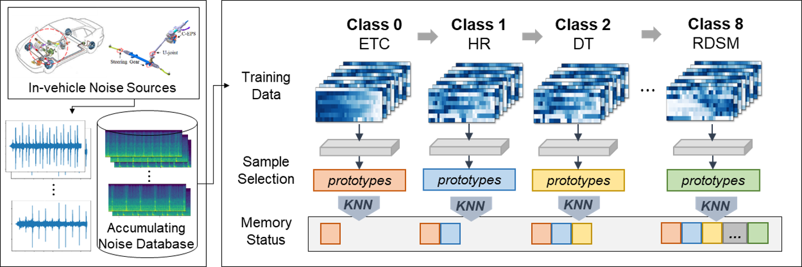

Our paper, *Dynamic Prototype-guided Memory Replay for In-Vehicle Noise Classification*, received the **SAS Student Paper Award** at the Conference of Korea Data Mining Society (KDMS) in June 2023.

In-vehicle noise classification is important for driver and passenger safety and comfort, and gives useful insight into a vehicle's performance and condition. Because automakers keep collecting new data, models need to learn new noise classes efficiently without losing performance on the old ones.

To address this, we proposed **dynamic prototype-guided episodic memory (DPEM)**, which stores only the most representative samples in episodic memory. DPEM uses clustering and prototype computation to adjust the number of prototypes dynamically, making memory use more efficient. We evaluated DPEM in a class-incremental learning pipeline on real in-vehicle noise data from a global automaker. It improved classification performance by 6.38 percentage points in the class-incremental setting, showing its promise for continual learning in automotive applications.
