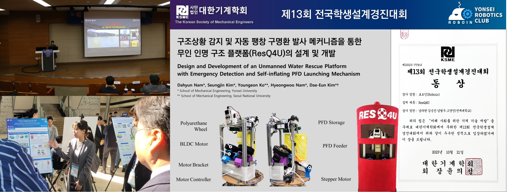

Our team received the **Excellent Project Award** at the 13th Student Creative Design Competition hosted by the Korean Society of Mechanical Engineers (KSME) in September 2023.

We built an unmanned water rescue robot that detects emergencies and launches self-inflating life jackets, for faster rescues near rivers and lakes.

Existing rescue devices are hard to use and must be operated by hand. Our robot combines an IR camera, a LiDAR and a machine learning object detection model, so it can detect people in the water at night and in places with no one around. It can rotate both horizontally and vertically, and uses a pitching-machine-style launcher to aim and throw the life jacket automatically. You can watch the system working on YouTube!

<iframe width="100%" height="400" src="https://www.youtube.com/embed/03CUmIzoZ04?si=oxhTjqde9j68zvTE" frameborder="0" allowfullscreen></iframe>

This work was also published in [Transactions of the KSME C: Industrial Technology and Innovation](https://doi.org/10.3795/KSME-C.2024.12.2.057) in 2024.
