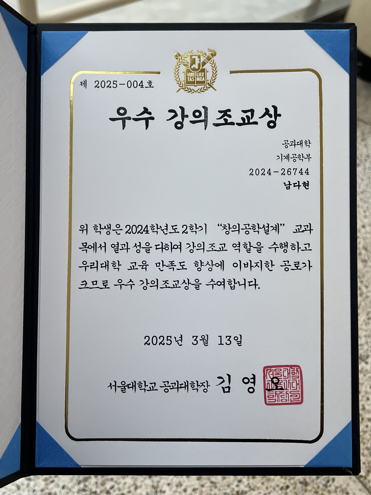

In March 2025, I received the **Excellent Teaching Assistant Award** from the College of Engineering, Seoul National University.

I was a TA for the undergraduate course Creative Design Engineering [400.018] in Fall 2024 (and again in Fall 2025). I built the reference robot for the class, a teleoperated mobile manipulator with its control algorithm, designed the competition field, and led the technical TA lectures and Q&A sessions.

You can watch the class robot competition on YouTube!
<iframe width="100%" height="400" src="https://www.youtube.com/embed/3DeRS-AGgY8" frameborder="0" allowfullscreen></iframe>
