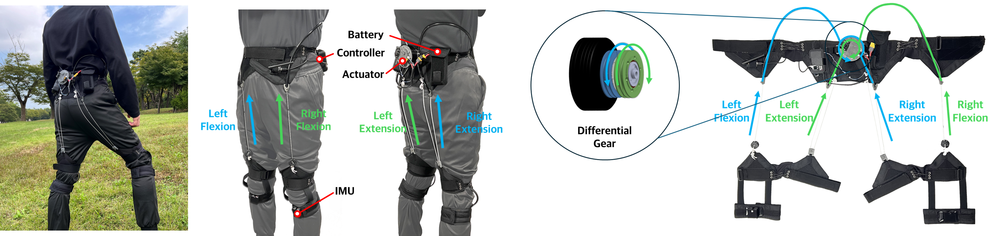
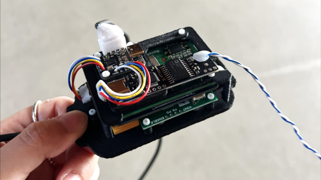
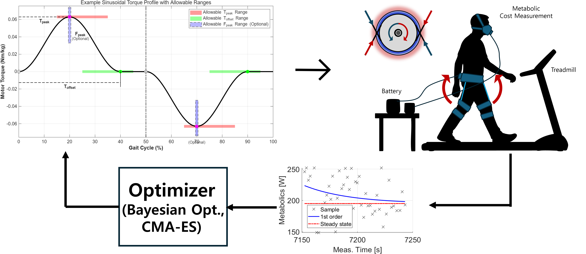

(This work is currently under review, so some materials cannot be disclosed yet. Please email me for more information!)
###### ㅤ
## Underactuated Hip Exosuit (Gram-Suit)
###### ㅤ
At the Biorobotics Lab, Seoul National University, we developed Gram-Suit, a sub-1 kg underactuated soft hip exosuit. Using a differential mechanism, a single motor provides four assistive torques: left and right hip flexion and extension. Two IMUs are used for gait estimation, and the whole system is integrated on ROS2.

###### ㅤ
### **What I Did :**
##### **1. Lightweight Controller**
I designed a custom I/O board based on the Raspberry Pi Compute Module 5 to control the exosuit.

###### ㅤ
##### **2. Human-in-the-loop Optimization**
I implemented a ROS2-based controller and applied CMA-ES–based human-in-the-loop optimization to automatically tune the assistance parameters for each user. MATLAB communicated wirelessly with the controller, enabling automated experiments and real-time metabolic cost evaluation.

