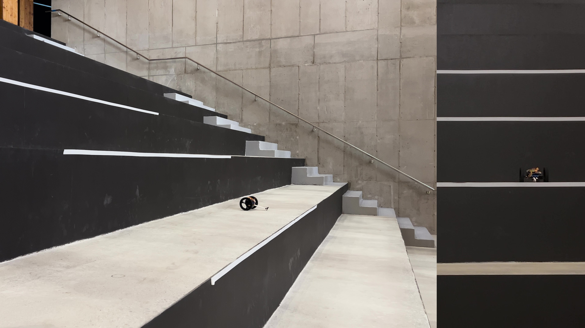
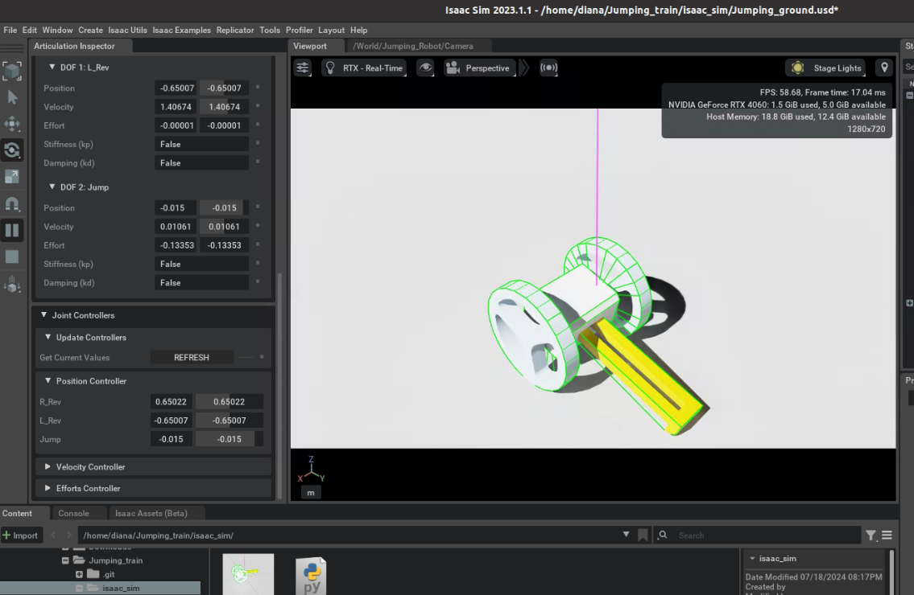

(This work has been accepted to the Journal of Field Robotics. Some materials are not disclosed yet. Please email me for more information!)
###### ㅤ
## Quasi-Direct-Drive Jumping Robot
###### ㅤ
At the Biorobotics Lab, Seoul National University, we developed a small-scale quasi-direct-drive jumping robot that drives on two wheels and jumps over a meter high. It uses a single quasi-direct-drive actuator for jumping and differential drive for wheeled locomotion.

###### ㅤ
### **What I Did :**
##### **1. Hardware Design**
I designed the jumping module and the robot's custom controller board. The jumping module uses a rack-and-pinion mechanism for quasi-direct actuation, and the controller board is built around an ARM Cortex-M7 MCU.
###### ㅤ
##### **2. Control Implementation**
I built a hierarchical Jetson Orin–MCU control system on ROS2, linking the high-level and low-level controllers over UART. I implemented BLDC motor control, IMU filtering and a two-wheel driving controller, and designed an impedance control strategy to reduce landing impact. I also developed an LQR-based attitude stabilization controller, connecting simulation, embedded control and experiments into one pipeline.

