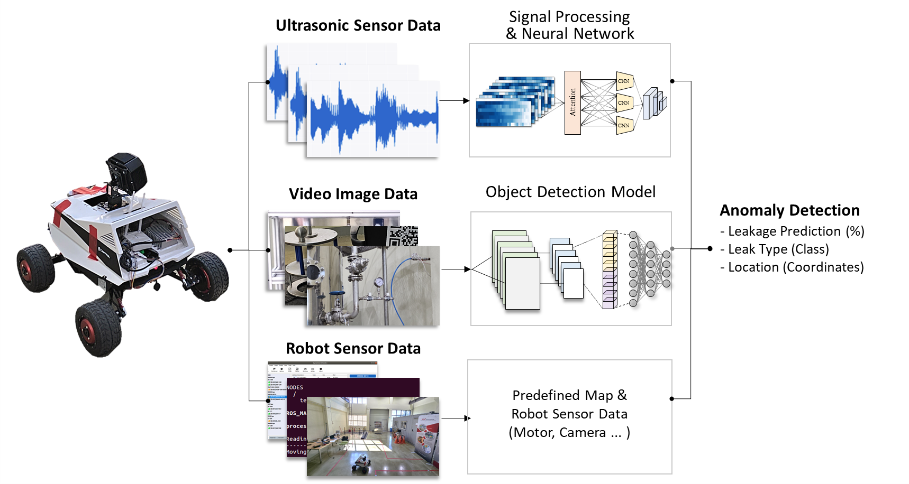
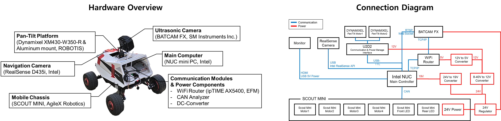
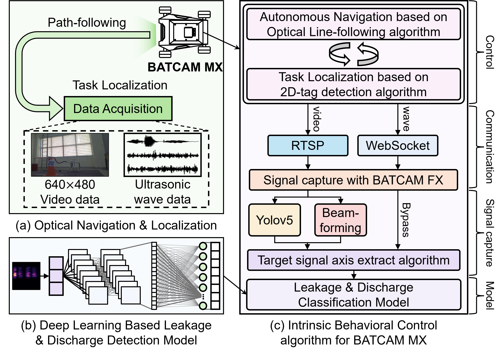
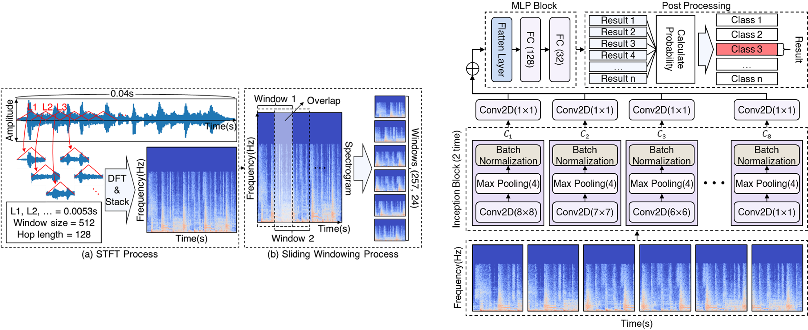

## Vision-Ultrasound Robotic System based on Deep Learning for Gas and Arc Hazard Detection in Manufacturing
### ㅤ
As an undergraduate researcher at the Soft Computing Lab, Yonsei University, I developed a deep learning-based robotic system that detects and classifies anomalies in manufacturing environments.

The system mimics how humans combine sight and sound to reason about their surroundings, while extending its perception range with directional ultrasonic sensing.

### **What I Did :**
##### **1. Hardware Development**
I built a custom robot on the AgileX Scout Mini mobile chassis, and designed a custom power circuit for the sensors and a pan-tilt system for pointing them.

##### **2. Autonomous Navigation System**
Using a RealSense D435i camera, the robot follows lanes, recognizes 2D tags placed in the field and stops when it detects obstacles. A PID controller handles lane following, and the 2D tags are used for localization. Depth data is also monitored to trigger an emergency stop if an obstacle stays in the path longer than a set time.

##### **3. Target Detection and Signal Enhancement**
I combined an object detection model with a beamforming network to locate critical components and improve ultrasonic signal quality. The robot carries a 112-channel ultrasonic camera that records sound and RGB frames in real time. When a target facility appears in the RGB frame, the pan-tilt system points the sensor at it, and the object detection model finds its critical components. The center of each detected component is then located on the ultrasonic microphone array with a grid search, and the sound signal is beamformed for post-run analysis.

##### **4. Deep Learning-Based Leak and Discharge Detection Model**
The leak and discharge classification model has three steps: 1) STFT and gamma correction, 2) Inception-block feature extraction, and 3) MLP classification. Its Inception-style CNN blocks use parallel convolution kernels of different sizes to capture multi-scale time-frequency features, and stacking them builds a hierarchical representation of complex ultrasonic patterns.

This work is currently under review at Engineering Applications of Artificial Intelligence. You can read the [preprint on arXiv](https://arxiv.org/abs/2502.05500)!

<iframe
  width="100%" height="400"
  src="https://www.youtube.com/embed/SZWnzXeCERg?si=Jrif8x4vgX6aPRn-&autoplay=1&mute=1"
  frameborder="0" allow="autoplay; encrypted-media" allowfullscreen>
</iframe>
