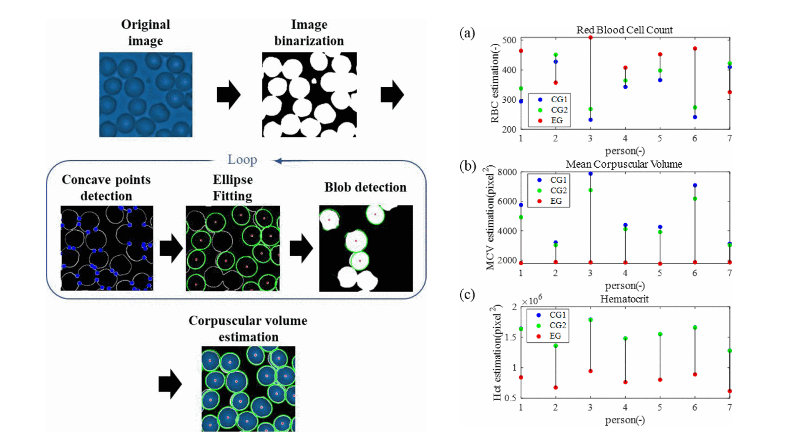

## Vision-based Complete Blood Count (CBC) Software Development
### ㅤ

In winter 2022, I was a research intern at the Center for Healthcare Robotics, Korea Institute of Science and Technology (KIST), Seoul, South Korea. I worked on software that estimates blood values from a microscope image of a small, undried blood sample.

To detect every blood cell in the image, we used an iterative algorithm combining concave point detection, ellipse fitting and blob detection. We validated the method against the Sysmex XN-1000, a widely used medical reference analyzer. The correlation coefficients were above 0.88, higher than those of methods from previous studies.

This work was published at the [23rd International Conference on Control, Automation and Systems (ICCAS 2023), pp. 1298–1303](https://doi.org/10.23919/ICCAS59377.2023.10316826).
