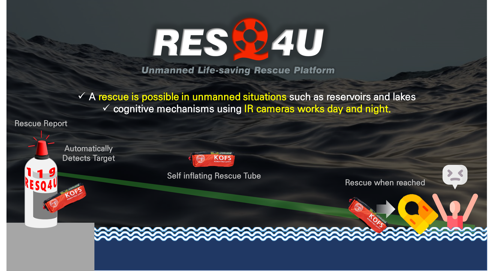
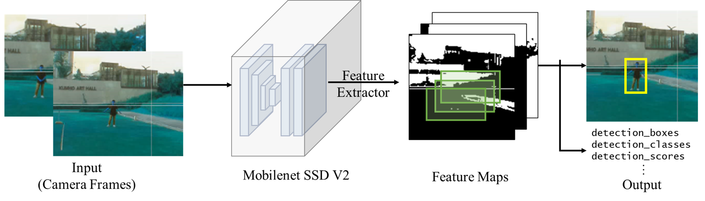
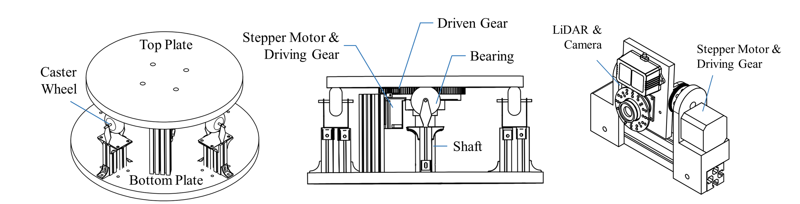
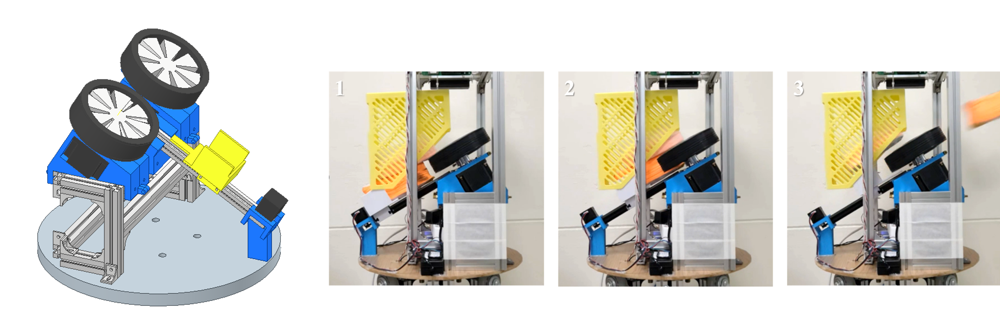

## Unmanned Water Rescue Robot: ResQ4U
### ㅤ
As an undergraduate, I developed an unmanned water rescue robot. It detects emergencies autonomously and accurately launches a self-inflating rescue tube to the person in the water. The system won several awards and was published in [Trans. Korean Soc. Mech. Eng. C](https://doi.org/10.3795/KSME-C.2024.12.2.057)!

  <!-- Image -->
  

  <!-- Video -->
  <iframe
    width="35%" height="160"
    src="https://www.youtube.com/embed/03CUmIzoZ04?si=J2b-9uis-7GliLWH"
    frameborder="0" allow="autoplay; encrypted-media" allowfullscreen>
  </iframe>

### ㅤ
### 1. Autonomous Emergency Detection
The system combines an IR camera, a LiDAR and a machine learning object detection model, so it can detect emergencies at night and in places with no one around.

The model runs continuously on the camera feed to detect whether a person has fallen into the water. It is a Single Shot Detector (SSD) with a MobileNet backbone, which gives fast detection on mobile hardware.

A sliding-window algorithm tracks detected rescue situations over time. Using a day/night camera module with an IR-cut filter, we validated the model in both daytime and nighttime conditions.

### ㅤ
### 2. Targeting Mechanism & Algorithm

The frame lets both the launching and detection modules rotate left and right, and lets the detection module also tilt up and down. For horizontal rotation, I designed a large turntable mechanism using a stepper motor, caster wheels, ball bearings and aluminum profiles, so it supports heavy loads while rotating smoothly.

### ㅤ
### 3. Automatic Launching Mechanism Design

To launch the rescue tube accurately, we designed a quasi-direct-drive launcher similar to a baseball pitching machine. Through repeated experiments, we mapped motor speed to throw distance, which made the launch distance controllable.

<iframe
  width="100%" height="400"
  src="https://www.youtube.com/embed/qVO7ZP8KgL4?si=mrC7ZubSV2nPYvvF&autoplay=1&mute=1"
  frameborder="0" allow="autoplay; encrypted-media" allowfullscreen>
</iframe>

The personal flotation devices (PFDs) are stored in a magazine for reloading. At launch, a PFD slides into the launcher along a linear guide, is slightly compressed between the two spinning wheels, and is shot forward by friction. The platform then moves back so the next PFD drops into place. This reloading mechanism lets the system run fully autonomously, without human help.
