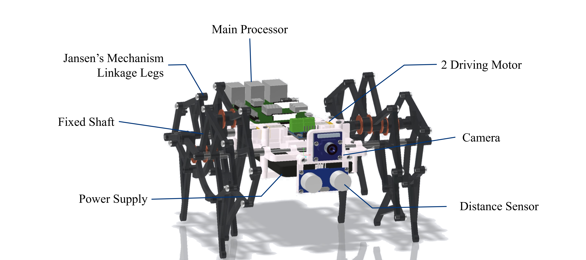

## Autonomous Legged Robot using Theo Jansen Linkage
### ㅤ

For an undergraduate course project, I built a legged robot based on the Theo Jansen linkage and entered it in a self-driving challenge. I designed the linkage in simulation, fabricated the robot myself and wrote the software for the challenge.
### ㅤ

### 1. Simulation and Modeling of the Jansen Mechanism

In V-REP, I modeled several linkage types that could serve as robot legs, and ran parameter studies on the leg, motor and frame properties.

<iframe
  width="100%" height="400"
  src="https://www.youtube.com/embed/1yakNY1jaRg?si=yN4dxsv4NL9vaxbX&autoplay=1&mute=1"
  frameborder="0" allow="autoplay; encrypted-media" allowfullscreen>
</iframe>

Based on the best parameter set I found, I designed the leg mechanism and assembled the robot with carbon rods for the leg axles and FDM-printed parts.

### ㅤ
### 2. Self-Driving Algorithm using Lane and Obstacle Detection
I developed the robot's self-driving algorithm with Python and OpenCV, using lane detection and a cascade classifier for obstacle detection.
